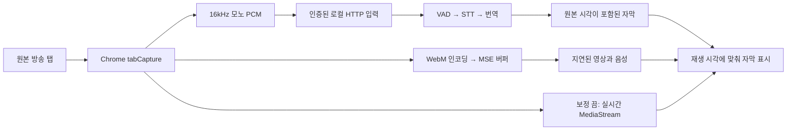

# 원본 음성 분리와 딜레이 보정

## 데이터 흐름



기존 WASAPI 루프백을 그대로 사용하면서 방송을 늦추면 번역 입력까지 늦어진다. 따라서 원본 탭을 계속 재생하고, 확장 프로그램의 별도 시청 탭이 영상과 음성을 함께 지연한다. 원본 사이트의 플레이어 위치나 비공개 API에 의존하지 않는다.

Chrome의 `tabCapture`는 선택한 탭의 영상·음성을 제공하며 캡처 중 원래 탭의 직접 출력은 중지한다. AudioWorklet은 원본을 16kHz 모노 float32 PCM으로 바꾸어 100ms 단위로 로컬 앱에 보낸다. 이 경로는 스피커에 연결하지 않는다. Worklet 출력은 무음이며, 사용자가 듣는 소리는 시청용 video 요소에서만 나온다.

앱에 브라우저 입력 세션이 있는 동안 WASAPI 샘플을 버리므로 지연된 재생음을 다시 번역하지 않는다. 브라우저 입력은 별도 mutex 큐를 사용해 기존 SPSC 링 버퍼의 단일 생산자 조건을 유지한다. 소비 스레드만 입력을 전환하며 전환 시 VAD의 진행 중 발화를 지운다. 인식·번역 작업에는 세션 ID를 복사하므로 이전 입력의 늦은 결과를 새 시청에 섞지 않는다. 세션이 다르면 번역 배칭과 문장 합치기도 분리한다.

## 시청 설정

각 모드는 `off / manual / auto` 및 기본 보정량을 독립적으로 저장한다.

| 모드 | 기본 정책 | 기본 보정량 |
| --- | --- | --- |
| 시청 | 수동 | 2.0초 |
| 채팅 | 끄기 | 2.0초, 보정을 켤 때 사용 |

수동 슬라이더 범위는 0~10초, 간격은 0.1초다. 자동 정책에서도 슬라이더로 시작 보정량을 바꿀 수 있다. 목표와 실제 지연, 최근 평균과 측정 건수를 별도로 표시한다.

- 수동·자동: 원본 탭 전체를 최대 1280×720, 30fps로 캡처하고 VP8/Opus WebM을 인코딩해 MSE에 공급한다. 영상과 음성은 같은 미디어 타임라인을 사용한다.
- 끄기: 인코딩 버퍼를 우회해 원본 MediaStream을 실시간 재생한다. 지연 video는 음소거·정지해 이중 출력을 막는다.
- 목표 지연 증가: 목표만큼 버퍼가 쌓일 때까지 잠시 대기한다.
- 목표 지연 감소: 최대 1.05배속으로 따라잡고 목표 근처에서 정상 속도로 복귀한다. 자동 보정으로 seek하지 않는다.
- 보정 끄기에서 켜기로 명시적으로 전환할 때만 현재 목표에 맞춰 버퍼 내 위치를 한 번 이동한다.

원본 탭은 계속 열어 두고 재생해야 한다. 원본의 채팅 조작은 ‘원본 탭·채팅 열기’로 돌아가서 한다. 캡처 대상은 영상 요소만이 아니라 원본 탭의 보이는 화면 전체다. 사이트의 극장 모드를 사용하면 영상 영역을 크게 볼 수 있다. 시청 창 전체 화면도 지원한다.

## 원본 시각과 자동 보정

PCM마다 세션 ID, 연속 패킷 번호, 샘플 마지막 시점의 Unix 밀리초를 보낸다. AudioContext 샘플 시계를 브라우저의 벽시계에 매핑하며, VAD 소비 시에는 최대 512샘플(32ms)씩 처리해 원본 시각을 따라간다. 발화 마지막 시점은 이 시각에서 VAD가 기다린 무음 시간을 뺀 값이다. VAD 창 경계와 캡처·코덱 처리에 따른 작은 오차는 남는다.

자막은 `audio_session`, `speech_ended_at_ms`, `latency_ms`, `final`을 포함한다. 시청 창은 원본 시각이 현재 지연 재생 위치에 도달할 때 표시한다. 자막이 늦게 도착하면 즉시 표시한다. 부분 번역은 같은 발화의 큐 항목을 교체하고, 뒤 발화와 합쳐진 결과는 뒤 발화 시점에 갱신해 앞 발화의 표시 기회를 남긴다.

자동 측정은 **발화 종료 → 완성 자막의 브라우저 도착**까지이며 VAD 대기, 인식·번역 대기열, 추론, 네트워크 전달 시간을 포함한다. 부분 토큰마다 중복 측정하지 않으며, 이번 시청의 최근 30개 완료 기록만 메모리에 보관한다. 모델·방송이 다른 이전 시청의 기록은 섞지 않는다. 기록에는 시각과 지연만 표시한다.

1. 처음 5건까지는 기본 보정량을 유지한다.
2. 0~60초 밖의 값과 비정상 수치는 제외한다.
3. 최근 기록의 중앙값에서 `max(0.5초, 중앙값 × 0.5)`보다 멀리 떨어진 값은 보정 계산에서 제외한다.
4. 남은 값의 평균에 0.3초 여유를 더한다.
5. 목표와 현재 보정량 차이의 15%를 반영하되 완료 기록 한 건당 변화는 최대 0.1초로 제한한다.
6. 최종 보정량은 0~10초로 제한한다. 상한 도달 여부를 화면에 표시한다.

화면의 ‘최근 평균’은 제외 전 실제 기록 평균이고, 자동 계산에는 이상치를 제외한 평균을 사용한다. 이 지표는 발화 **종료** 기준으로, 긴 문장의 첫 음절부터 자막을 미리 보장한다는 의미는 아니다. 10초보다 오래 걸리는 번역, 인코더의 최소 지연, 예외적으로 늦은 결과는 완벽히 보정할 수 없다.

## 수명과 오류 처리

- 한 번에 한 방송 탭·시청 세션만 허용한다. 새 창 시작은 방송 탭에서 확장 프로그램 버튼을 눌러 수행한다.
- 스트림 ID는 수명이 짧으므로 ‘시청 시작’ 버튼에서 새로 발급받는다. 마이크 권한을 요청하지 않고 지정한 원본 탭만 사용한다.
- 앱의 페어링 인증 및 확장 프로그램 Origin 검증을 PCM API에도 그대로 적용한다.
- PCM은 패킷당 최대 4096샘플, 큐 최대 2초다. 중복·순서 역전·비정상 진폭·오래된 타임스탬프를 거부한다. 브라우저 전송 큐도 2초로 제한하며 과부하 때 종료해 무제한 메모리 증가를 막는다.
- MSE는 재생 위치 앞의 오래된 데이터를 제거한다. 실시간 경로에서도 인코딩 버퍼는 최근 구간만 유지한다.
- 중지·시청 창 닫기·원본 탭 닫기·캡처 종료·전송 오류 때 트랙과 재생을 종료하고 브라우저 입력 세션을 해제한다. 앱은 패킷이 5초 이상 끊기면 세션을 만료해 WASAPI로 복귀한다.
- 재생 기록과 원본 영상은 디스크에 저장하지 않는다. 모드·정책·슬라이더 설정만 확장 프로그램 로컬 저장소에 보관한다.

Chrome/Edge 116 이상이 필요하다. DRM 또는 사이트·브라우저 캡처 제한으로 화면이 비거나 캡처가 거부될 수 있다. 기존 인페이지 자막은 보정 시청을 사용하지 않을 때 그대로 유지된다.

## 검증

```powershell
node --test extension/tests/*.test.cjs
cmake --preset windows-x64-debug -DOVERLAY_BUILD_AUDIO_TESTS=ON -DOVERLAY_BUILD_CLI_TESTS=ON
cmake --build --preset windows-x64-debug --target OverlayTransWin overlay_browser_audio_tests overlay_cli_tests
ctest --test-dir build/settings-debug/core -C Debug --output-on-failure
ctest --test-dir build/settings-debug/windows -C Debug --output-on-failure
```

`extension/tests/viewer-browser.cjs`는 Playwright Core와 Chromium을 사용하는 선택적 브라우저 검증이다. `PLAYWRIGHT_MODULE`에 설치된 모듈 경로, `CHROMIUM_PATH`에 Chromium 실행 파일을 지정한다. 캡처 API만 합성 스트림으로 대체하고 실제 AudioWorklet, MediaRecorder, MSE, PCM HTTP 전송, 자막 표시, 모드 전환, 캡처 해제를 검증한다. 실제 방송 사이트의 캡처 권한·DRM·장시간 재생·음성 번역 품질은 별도 현장 검증 대상이다.

참고: [Chrome tabCapture](https://developer.chrome.com/docs/extensions/reference/api/tabCapture), [MediaRecorder](https://developer.mozilla.org/en-US/docs/Web/API/MediaRecorder), [SourceBuffer.appendBuffer](https://developer.mozilla.org/en-US/docs/Web/API/SourceBuffer/appendBuffer).
